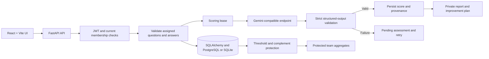

# AI Pulse

**A privacy-conscious AI-habits assessment pilot with strict scoring validation, tenant-aware access controls, protected team insights, and private improvement plans.**

[](https://ai-pulse-rho-one.vercel.app/)
[](https://aipulse-backend-msyi.onrender.com/health)
[](docs/VERIFICATION.md)
[](docs/ROLLOUT.md)

AI Pulse explores how people use AI at work and turns self-reported habits into private reports, while showing leaders only sufficiently large, protected team-level aggregates.

This is an engineering pilot, not a validated employee-performance or employment-decision system.

**Live app:** [Vercel Frontend](https://ai-pulse-rho-one.vercel.app/) · [Render API](https://aipulse-backend-msyi.onrender.com/) · [GitHub Repository](https://github.com/hardikkaurani/ai-pulse)

## Features

- Role-aware assessments based on job role and seniority.
- Private employee reports and a one-week improvement plan.
- Organization-aware authentication and authorization.
- Protected department averages, headcounts, and risk counts.
- Strict validation of AI-generated structured output.
- Retryable assessment states when AI scoring fails.
- Assessment, questionnaire, rubric, model, and scoring-mode provenance.
- Personal assessment-data deletion.
- Database migrations and legacy-data preservation.
- Isolated synthetic-data rehearsal workflows.
- Production health checks and deployment configuration.

## Live Demo Accounts

All demo accounts use the password `pulse123`.

| Account | What to explore |
| --- | --- |
| `asha@northwind.test` | Northwind admin dashboard |
| `priya@northwind.test` | Employee report, improvement plan, deletion |
| `new@northwind.test` | Support assessment and retake |
| `dev@northwind.test` | Engineering assessment |
| `ravi@consult.test` | Multi-organization access and role switching |
| `meera@bluepeak.test` | Bluepeak admin dashboard |

**Use fictional answers only.** These are shared, mutable demo accounts and are not suitable for real employee data. Free hosting may sleep when idle, so the first request can take around a minute.

## Architecture



The public Vercel frontend and Render API use separate origins. The frontend API URL and backend CORS allowlist must agree. The root Docker deployment can also serve the frontend and API from one origin.

## Major Bugs Found and How They Were Fixed

| Issue | Root cause | Fix |
| --- | --- | --- |
| Cross-organization access | Organization context alone is not authorization. | Verify current membership and role for protected requests; reject access to organizations the user does not belong to. |
| Stale role permissions | A user's role or membership may change after token issuance. | Resolve current database membership and role during protected operations; test role demotion and membership deletion. |
| Partial or duplicate answers | Incomplete or duplicated submissions could affect results and participation counts. | Validate answers against the exact assigned question snapshot and count only completed assessments once per person. |
| Small-group privacy leaks | Small departments or risk counts could reveal individual information. | Suppress groups below five and protect risk counts unless both flagged and unflagged groups meet the threshold. |
| Complement disclosure | A published risk count could reveal a small unflagged group by subtraction. | Require at least five people on both sides before publishing a risk count. |
| Unassigned-row disclosure | The row's appearance could reveal the first completion or last deletion in a small group. | Derive the row from organization membership rather than assessment completion. |
| Inconsistent deletion | Answers, reports, and activities could be removed inconsistently. | Delete owned assessment data transactionally, update dashboard eligibility, and test repeated deletion. |
| Late AI results after deletion | A scoring operation could finish after the corresponding assessment was deleted. | Use revision and scoring-state checks to prevent stale results from restoring deleted state. |
| Concurrent or stale scoring | An older worker could overwrite a newer attempt. | Use scoring leases and revision checks to reject stale worker results. |
| Malformed AI output | Invalid JSON, incorrect types, out-of-range scores, duplicate keys, or unknown risk labels could corrupt results. | Strictly validate structured output and reject invalid responses. |
| AI provider timeouts and errors | HTTP 429/503, timeouts, or provider failures could interrupt scoring. | Preserve pending state and offer retry; never silently fabricate scores or switch models. |
| AI rubric ambiguity | Early synthetic model checks exposed risk-label and score-boundary inconsistencies. | Clarify the rubric and risk definitions; record model evaluation results and add regression tests. |
| Invalid browser dates | An AI-generated date-validation rule rejected valid browser date representations. | A failing test exposed the issue; correct date parsing while retaining strict boolean validation for completion. |
| Session lost during temporary failures | Transient workspace-loading errors incorrectly cleared a valid session. | Preserve the session and allow retry on transient failures; clear it on actual HTTP 401 responses. |
| Oversized requests and abuse | Large request bodies and repeated requests can waste resources or enable abuse. | Add request-size limits, input validation, and rate limiting with proxy-aware client IP handling. |
| Migration and legacy-data risk | Schema changes could break existing data or misinterpret incomplete legacy answers. | Use Alembic migrations, test fresh and repeat upgrades, preserve legacy data, and exclude incomplete legacy assessments from completed-result counts. |
| Hosted startup failures | Missing secrets, invalid configuration, port binding, migration, or readiness problems could prevent startup. | Validate required configuration, run migrations before serving, respect the host-provided port, and verify health/readiness endpoints. |
| Production login failure | The Vercel origin was absent from the effective CORS allowlist, so the browser's preflight failed before the login POST. | Preserve the trusted Vercel origin in the CORS allowlist and add regression coverage for preflight behavior. |
| Missing demo users on Render | The deployed PostgreSQL database had schema migrations but no seeded demo users. | Run the existing idempotent seed function for an empty demo database without resetting existing data. |
| Rehearsal data mixing | Destructive testing could affect the main local demonstration database. | Use an isolated synthetic database and signing key, separate ports, and forced mock scoring for rehearsal workflows. |

## Production Login Incident

The frontend displayed:

> Cannot reach AI Pulse. Check that the API is running and try again.

The actual failure was a CORS preflight rejection. The browser sent an `OPTIONS /auth/login` request with origin `https://ai-pulse-rho-one.vercel.app`, and the backend returned `400 Disallowed CORS origin`.

The backend configuration had allowed the Render-provided external URL to replace the default origin list. This could leave the backend's own hostname allowed while excluding the Vercel frontend.

A second issue was discovered: the hosted PostgreSQL database had no demo users. Even after CORS was corrected, valid demo credentials would still have received HTTP 401.

### Resolution

1. Updated the CORS configuration to retain the trusted Vercel frontend origin.
2. Added regression tests for the production preflight and login behavior.
3. Corrected the demo seeding path so synthetic accounts can be created in an empty demo database without resetting existing data.
4. Rechecked the login flow after the changes.

**Outcome:** The user confirmed that the live login worked after the agent's fix.

This confirms the reported login blocker was resolved at that point. It does not guarantee that future deployments or third-party hosting will always remain healthy.

## Optimisation and Engineering Decisions

- **Validate before completing:** Only valid answers to the exact assigned questions can produce a completed assessment.
- **Explicit lifecycle states:** Failed scoring remains pending and retryable rather than producing a fabricated result.
- **Stale-worker protection:** Scoring leases and revision checks prevent late results from replacing newer submissions.
- **Rule-based improvement plans:** Recommendations remain explainable and do not require another AI call or change assessment scores.
- **Privacy at aggregation time:** Small groups and small complements are suppressed instead of inferred from published totals.
- **Bounded model requests:** Structured output is validated, and model provenance is stored with the assessment.
- **Database safety:** Fresh migrations, repeated upgrades, and legacy-data preservation are tested.
- **Isolated rehearsals:** Destructive test scenarios run against disposable synthetic data.
- **Explicit configuration:** Secrets stay in backend environment settings, not in frontend code or Git.
- **Evidence-based performance claims:** The recorded load test is limited to 100 requests at concurrency 5. It is a pilot measurement, not proof of high-scale capacity.

## Verification

Run the project's check command from the repository root:

```bash
python scripts/check.py
```

The repository's verification record documents the following results:

| Check | Recorded result |
| --- | --- |
| Backend tests | 103 passed; one PostgreSQL integration test skipped in the default local run |
| Frontend interface tests | 10 passed |
| Production frontend build | Passed |
| Security and authorization suite | 13 passed in the recorded security suite |
| PostgreSQL integration | One test passed in GitHub Actions against PostgreSQL 18 |
| Database migrations | Fresh/repeated upgrade and legacy-data preservation passed |
| Dependency audit | No known vulnerabilities reported by the recorded Python and npm audit tools |
| Linux hosted container | Build/startup smoke test and readiness probe included in CI |
| Pilot load test | 100 requests, concurrency 5; p50 71.63 ms, p95 187.83 ms, zero errors |

See [docs/VERIFICATION.md](docs/VERIFICATION.md) for detailed test scope, browser checks, model experiments, regression history, and limitations.

These results describe documented runs; they do not guarantee the current state of a third-party hosted service.

## AI Scoring and Evaluation

The documented live configuration uses an OpenAI-compatible Gemini endpoint with model `gemini-3.5-flash-lite` and rubric `pulse-rubric-v3`.

Gemini 3.8 Flash encountered timeouts and HTTP 503 high-demand responses in the recorded tests. The demonstrated model was changed explicitly. The application does not silently switch models when a request fails.

The verification record documents:

- **Rubric v1:** 10/10 valid outputs, 10/10 score ranges, 8/10 exact risk-set matches.
- **Rubric v2:** 10/10 valid outputs, 9/10 score ranges, 10/10 exact risk-set matches.
- **Rubric v3:** 10/10 valid outputs, 10/10 score ranges, 10/10 exact risk-set matches on the same author-written development cases.
- **Fresh synthetic cases:** Eight cases frozen before model calls matched expected scores and risk sets.

These are small author-written test sets. The v3 result is calibration evidence, not an unbiased accuracy benchmark or independent domain validation.

Scores describe self-reported habits, not verified job performance. They should not be used as the basis for employment decisions.

Configuration details: [docs/AI_SCORING.md](docs/AI_SCORING.md).

## Local Development

### Requirements

- Python 3.12+
- Node.js 24
- npm
- Git

### Start the Application

From the repository root:

```bash
python scripts/setup.py --demo
python scripts/run.py
```

Open:

- Frontend: [http://127.0.0.1:5173](http://127.0.0.1:5173)
- FastAPI documentation: [http://127.0.0.1:8000/docs](http://127.0.0.1:8000/docs)

The setup script installs dependencies, generates a private signing key, and preserves existing data. Local mode defaults to labelled demo scoring and does not require a provider API key.

To configure live scoring, follow [docs/AI_SCORING.md](docs/AI_SCORING.md).

Keep `SECRET_KEY` and `LLM_API_KEY` in private backend environment configuration. Never commit them or expose them through frontend variables.

## Documentation

- [Architecture and design decisions](docs/ARCHITECTURE.md)
- [AI scoring and provider configuration](docs/AI_SCORING.md)
- [Deployment and hosting guide](docs/DEPLOYMENT.md)
- [Verification record and limitations](docs/VERIFICATION.md)
- [Operational runbook](docs/RUNBOOK.md)
- [Rollout considerations](docs/ROLLOUT.md)

## Deployment and Operational Limits

The repository includes a Render Blueprint and a Docker-based hosted startup path. The Blueprint uses a separate hosted PostgreSQL database and a generated signing secret. Confirm which Render service and frontend configuration are connected before deploying; the project also documents a split Vercel frontend and Render backend.

Important limitations:

- Public demo accounts are shared and mutable.
- The free hosted database expires after its limited lifetime unless upgraded or exported.
- Managed production backups and a full disaster-recovery exercise remain outstanding.
- SSO and identity provisioning remain outstanding.
- Sustained higher-concurrency testing and distributed rate limiting remain future work.
- Broad cross-browser coverage and a comprehensive accessibility audit remain outstanding.
- Provider and backup retention require explicit policies.
- Database deletion does not guarantee erasure from backups or external provider systems.
- The service is a single-worker pilot, not a high-scale production system.

See [docs/DEPLOYMENT.md](docs/DEPLOYMENT.md), [docs/RUNBOOK.md](docs/RUNBOOK.md), and [docs/ROLLOUT.md](docs/ROLLOUT.md) before using the application with real data.

## AI Assistance Disclosure

Codex assisted with source analysis, implementation, test generation, debugging, and documentation. AI suggestions were treated as hypotheses to verify, not as automatically correct changes.

One AI-generated date-validation rule rejected valid browser dates. A failing test exposed the defect, and the date-parsing logic was corrected while the completion field remained a strict boolean.

AI-assisted source review also helped identify privacy edge cases: a small complementary risk group could be inferred by subtraction, and the Unassigned row's appearance could reveal participation changes. These defects were reproduced, fixed, and covered with regression tests.

During the production login investigation, the agent traced the generic fetch error to a CORS preflight rejection and identified the separately unseeded demo database. The allowlist and demo seeding path were adjusted, regression tests were added, and the user confirmed that login worked.

AI-assisted review and synthetic tests have important limits. They are not equivalent to independent security certification, independent model validation, or a full production-readiness audit. The maintainer remains responsible for reviewing changes, checking test output, validating deployment configuration, and documenting residual risks.

## Known Limitations

- Live-model semantic evaluation is based on a small set of author-written synthetic cases.
- The recorded load test is a small pilot test, not proof of high-scale capacity.
- Passing automated tests, a container smoke test, and a successful demo journey do not establish full production readiness.
- The application runs as a single-worker pilot.
- SSO, identity provisioning, managed backups, and a full disaster-recovery exercise remain outstanding.
- Broader cross-browser testing and a comprehensive accessibility audit remain outstanding.
- Demo accounts are shared and mutable; do not submit real employee data.
- Free hosting may sleep when idle, and the hosted database expires after its limited lifetime unless upgraded.
- Provider and backup retention require explicit policies; deletion from the live database does not guarantee erasure from backups or third-party systems.

---

Built as an engineering project exploring privacy-aware assessment workflows, safe LLM integration, tenant isolation, reliable deployment, and evidence-driven debugging.
