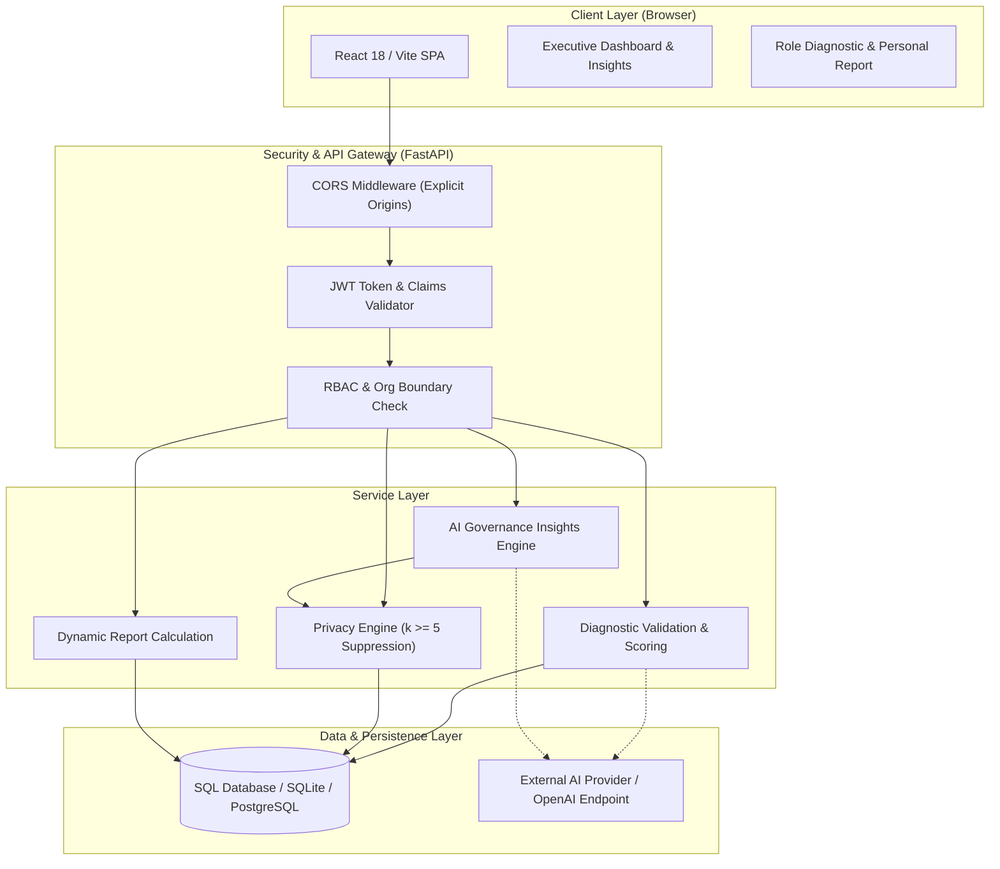
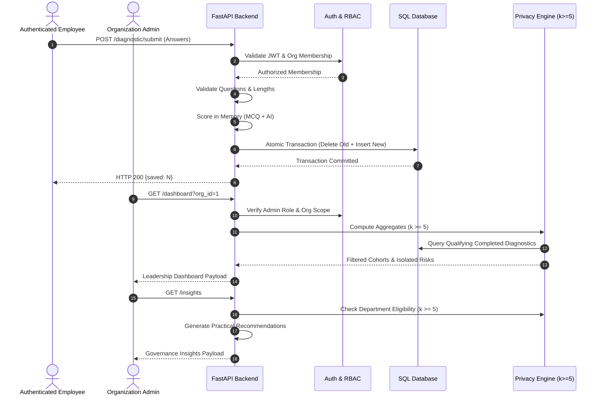

# AI Pulse — Enterprise AI Readiness & Governance Platform

AI Pulse provides organizations with privacy-preserving, department-level visibility into how employees adopt artificial intelligence at work. It couples role-adaptive employee diagnostics with automated AI-assisted evaluation, small-group privacy safeguards ($k \ge 5$), atomic resubmission guarantees, actionable governance insights, and authenticated employee data sovereignty (Right-to-Delete).

---

## 1. Problem Statement

As generative AI tools become ubiquitous across business workflows, enterprises face twin challenges:

1. **Visibility Deficit**: Leadership lacks objective data on where AI is driving efficiency versus where employees are held back by policy ambiguity or lack of tooling.
2. **Privacy & Trust Risk**: Traditional employee surveys expose individual answers and small teams (e.g., 2–4 members) to managerial de-anonymization and retaliatory scrutiny, suppressing honest reporting of shadow AI and data risks.
3. **Data Security & Sovereign Rights**: Employees and compliance officers require verifiable guarantees that personal diagnostic disclosures can be permanently deleted under GDPR and CCPA mandates without breaking organizational reports.

AI Pulse resolves these tensions by providing **mathematically enforced small-group suppression**, **cryptographically signed organization boundaries**, **strict input validation**, and **dynamic aggregate metric computation**.

---

## 2. Key Capabilities

- **Role & Seniority-Adaptive Diagnostics**: Questions dynamically adapt to department roles (Engineering, Sales, Support, HR, Management) and hierarchical seniority levels (Junior, Mid, Senior, Lead).
- **Strict Diagnostic Validation & Atomic Resubmission**: Submissions require exactly the assigned questions, reject invalid MCQ choices or free-text answers $<10$ characters, and replace previous submissions atomically within a single database transaction.
- **Privacy-Safe Executive Dashboard ($k \ge 5$)**: Departments with fewer than 5 completed diagnostics are automatically suppressed. Cohorts with 2 or more small departments totaling $\ge 5$ respondents are grouped into an `"Other teams"` aggregate.
- **AI-Powered Governance Insights**: Synthesizes actionable operational recommendations and risk mitigation steps from aggregate department patterns without processing individual employee records. Operates in deterministic mock mode or connects to live LLM APIs with graceful fallback.
- **Employee Right-to-Delete (Data Sovereignty)**: Authenticated employees can permanently erase their responses scoped to their active organization. Analytics recalculate on-the-fly with zero cached staleness.
- **Hardened Authentication & Isolation**: Bcrypt password hashing with transparent legacy migration, time-bounded JWT access tokens with strict claim validation, and complete Broken Object Level Authorization (BOLA / IDOR) prevention.

---

## 3. System Architecture



---

## 4. Request & Data Flow



---

## 5. Feature Matrix

| Feature | Implementation Status | Technical Details |
|---|---|---|
| **Multi-Org Membership Auth** | ✅ Fully Implemented | Scoped JWT tokens with `sub`, `org`, `exp`, `iat`, and `type: access`. |
| **BOLA / IDOR Protection** | ✅ Fully Implemented | Enforced on every route via `current_membership` database validation. |
| **Bcrypt Password Security** | ✅ Fully Implemented | Salted bcrypt with 12 rounds and transparent legacy SHA-256 migration. |
| **Seniority-Rank Hierarchy** | ✅ Fully Implemented | Explicit integer mapping (`junior: 1` to `lead: 4`). |
| **Strict Diagnostic Validation** | ✅ Fully Implemented | Exact question matching, length limits, MCQ verification, and atomic commit. |
| **Small-Group Privacy Engine** | ✅ Fully Implemented | Deterministic $k \ge 5$ threshold, "Other teams" dual-condition aggregation. |
| **Risk Flag Isolation** | ✅ Fully Implemented | Flags from suppressed departments are excluded from organization top risks. |
| **Employee Right-to-Delete** | ✅ Fully Implemented | Atomic `DELETE /reports/me` scoped strictly to active membership ID. |
| **Department AI Insights** | ✅ Fully Implemented | Structured actionable advisory with priority tagging, mock mode, and rule fallback. |
| **Differential Privacy Noise** | ❌ Not Implemented (Intentional) | Uses deterministic suppression controls rather than mathematical noise injection. |
| **Multi-Factor Auth (MFA)** | 🔮 Future Roadmap | Planned for enterprise SSO (SAML 2.0 / OIDC) integration. |

---

## 6. Engineering Improvements & Problems Solved

| Area | Original Problem | Implemented Fix | Verification |
|---|---|---|---|
| **Broken Object Level Authorization (BOLA / IDOR)** | `/auth/select-org` allowed obtaining tokens for arbitrary `org_id` values without membership checks. `/dashboard` allowed querying organizations outside the user's authorized scope. | Enforced database membership check in [`backend/app/routes/auth_routes.py`](backend/app/routes/auth_routes.py) returning 403 on mismatch. Enforced `m.role == "admin"` and `target_org_id == m.org_id` in [`backend/app/routes/dashboard.py`](backend/app/routes/dashboard.py). | Verified in [`backend/tests/test_api.py`](backend/tests/test_api.py) and [`test_security_hardening.py`](backend/tests/test_security_hardening.py). |
| **Small-Group Privacy** | Raw department scores and risk flags were exposed regardless of cohort size, allowing individual employees in small teams (1–4 respondents) to be de-anonymized. | Centralized `PRIVACY_THRESHOLD = 5` in [`dashboard.py`](backend/app/routes/dashboard.py). Suppressed departments are excluded from individual display and risk summaries. "Other teams" aggregate requires $\ge 2$ small departments and total completed respondents $\ge 5$. | 10 tests in [`backend/tests/test_dashboard_privacy.py`](backend/tests/test_dashboard_privacy.py) and adversarial check in [`test_regression_suite.py`](backend/tests/test_regression_suite.py). |
| **Department Score Aggregation** | Department scores directly averaged raw response rows, allowing multiple submissions or incomplete diagnostics to distort departmental averages. | Built two-step population averaging: first calculate distinct employee averages ($\bar{s}_i$) across expected questions, then average across qualified respondents in [`dashboard.py`](backend/app/routes/dashboard.py). | Verified in [`backend/tests/test_dashboard_privacy.py`](backend/tests/test_dashboard_privacy.py). |
| **Diagnostic Validation & Resubmission** | `/diagnostic/submit` accepted arbitrary questions from the global question bank, permitted duplicate submissions, and had no answer length validation. | Enforced exact question-set match against authenticated member's role and seniority in [`backend/app/routes/diagnostic.py`](backend/app/routes/diagnostic.py). Added validation for blank answers, MCQ options, and min 10 / max 2000 character limits. Atomic database replacement ensures no duplicate records. | 9 tests in [`backend/tests/test_diagnostic_validation.py`](backend/tests/test_diagnostic_validation.py). |
| **Employee Right-to-Delete** | Employees had no mechanism to delete their diagnostic responses or personal evaluation reports. | Implemented authenticated [`DELETE /reports/me`](backend/app/routes/reports.py) and alias `/diagnostic/my-data`. Scoped strictly to authenticated membership ID with explicit transaction rollback on error. Reports recalculate immediately. | 8 tests in [`backend/tests/test_deletion.py`](backend/tests/test_deletion.py). |
| **Seniority and Question Filtering** | Seniority comparison used lexicographical string comparison (`"lead" < "senior"` evaluated to `True`), preventing lead engineers from receiving senior questions. | Introduced explicit numeric rank mapping in [`backend/app/services/questions.py`](backend/app/services/questions.py): `SENIORITY_RANKS = {"junior": 1, "mid": 2, "senior": 3, "lead": 4}`. | 7 tests in [`backend/tests/test_questions.py`](backend/tests/test_questions.py). |
| **AI Response Parsing & Scoring** | The scoring service failed on Markdown code fences, text-formatted numbers (`"four"`), out-of-bound scores, or unrecognized risk flags. | Implemented fence cleaning, regex extraction, score clamping (1.0–5.0), word-to-number mapping, and risk allowlist in [`backend/app/services/scoring.py`](backend/app/services/scoring.py). | 10 tests in [`backend/tests/test_scoring.py`](backend/tests/test_scoring.py). |
| **Department Governance Insights** | Leadership dashboard lacked actionable, privacy-filtered operational guidance. | Created [`backend/app/routes/insights.py`](backend/app/routes/insights.py) and [`backend/app/services/insights_service.py`](backend/app/services/insights_service.py). Provides practical governance actions derived strictly from privacy-cleared aggregates ($k \ge 5$) with deterministic rule fallback. | 7 tests in [`backend/tests/test_insights.py`](backend/tests/test_insights.py). |
| **Authentication & Hashing Hardening** | Passwords used plain unsalted SHA-256; wildcard CORS was enabled; startup configuration lacked validation. | Upgraded to bcrypt (12 rounds) with transparent legacy SHA-256 migration in [`backend/app/auth.py`](backend/app/auth.py). Added production secret enforcement in [`config.py`](backend/app/config.py) and explicit origin controls in [`main.py`](backend/app/main.py). | 10 tests in [`backend/tests/test_security_hardening.py`](backend/tests/test_security_hardening.py). |
| **Continuous Integration & Regression** | Repository lacked an automated CI pipeline and comprehensive edge-case regression coverage. | Configured GitHub Actions matrix workflow (`.github/workflows/ci.yml`) running Python 3.11, 3.12, 3.13 backend suites and Node.js 20 frontend production build. Added regression suite for prompt injection, differencing attacks, and oversized payloads. | All 78 tests pass in automated test runs. |

---

## 7. Technology Stack

- **Backend**: Python 3.11 / 3.12 / 3.13, FastAPI 0.115, SQLAlchemy 2.0, PyJWT 2.10, Bcrypt 5.0, HTTPX, SQLite / PostgreSQL.
- **Frontend**: React 18, Vite 5.4, Native CSS Variables (zero external heavy UI dependencies).
- **Containerization**: Docker, Docker Compose, Multi-stage frontend build with Nginx Alpine.
- **CI / Quality Gates**: GitHub Actions, Pytest 8.3, ESLint / Vite build verification.

---

## 8. API Specification

### Authentication

#### `POST /auth/login`
Authenticates a user and issues an unscoped user JWT.
```json
// Request
{
  "email": "asha@northwind.test",
  "password": "pulse123"
}

// Response: HTTP 200
{
  "token": "eyJhbGciOiJIUzI1Ni...",
  "name": "Asha Rao",
  "organizations": [
    { "org_id": 1, "org_name": "Northwind Logistics", "role": "admin" }
  ]
}
```

#### `POST /auth/select-org`
Verifies membership and issues an organization-scoped session JWT.
```json
// Request (Bearer token in Authorization header)
{
  "org_id": 1
}

// Response: HTTP 200
{
  "token": "eyJhbGciOiJIUzI1Ni...",
  "org_id": 1,
  "role": "admin"
}
```

### Diagnostic Assessment

#### `GET /diagnostic/questions`
Returns questions customized to the employee's role and seniority. Does not expose internal points.

#### `POST /diagnostic/submit`
Atomically validates, scores, and saves diagnostic responses.
```json
// Request
{
  "answers": [
    { "question_id": "common-freq", "answer": "Daily" },
    { "question_id": "common-open", "answer": "I use internal AI assistants to summarize documentation." }
  ]
}

// Response: HTTP 200
{
  "saved": 2
}
```

#### `DELETE /reports/me` (Alias: `DELETE /diagnostic/my-data`)
Permanently deletes all diagnostic answers for the authenticated employee within the active organization.
```json
// Response: HTTP 200
{
  "deleted": 2,
  "message": "All diagnostic answers and report data deleted successfully"
}
```

### Leadership & Governance

#### `GET /dashboard?org_id=1`
Returns privacy-preserving department aggregations ($k \ge 5$) and top risks for organization administrators.

#### `GET /insights?department_id=1`
Returns actionable organizational recommendations derived from qualifying department risk patterns.
```json
// Response: HTTP 200
{
  "organization": "Northwind Logistics",
  "department": "Support",
  "source": "rules",
  "insights": [
    {
      "department": "Support",
      "observed_pattern": "Customer data shared with external AI tools without clear redaction boundaries (2 instances).",
      "recommended_action": "Deploy enterprise-managed AI accounts with zero data retention and implement client data masking guidelines.",
      "reason": "Protects client confidentiality, prevents regulatory breaches (GDPR/SOC 2), and reduces third-party data leakage risks.",
      "priority": "high"
    }
  ],
  "hidden_small_groups": true
}
```

---

## 9. Local Setup & Execution

### Option A: Docker Compose (Recommended)

1. **Start the complete stack**:
   ```bash
   docker compose up -d --build
   ```
2. **Access services**:
   - Frontend: [http://localhost:3000](http://localhost:3000)
   - Backend API Health: [http://localhost:8000/health](http://localhost:8000/health)
3. **Stop the stack**:
   ```bash
   docker compose down
   ```

### Option B: Bare-Metal Setup

#### Backend:
```bash
cd backend
python -m venv .venv
# Activate virtual environment:
# Windows: .venv\Scripts\activate
# Linux/macOS: source .venv/bin/activate

pip install -r requirements.txt
python -m app.seed
uvicorn app.main:app --reload --port 8000
```

#### Frontend:
```bash
cd frontend
npm install
npm run dev
# Frontend runs at http://localhost:5173
```

---

## 10. Running Test Suites

All 78 tests execute against isolated, temporary SQLite test databases outside the workspace:

```bash
# Run complete test suite
python -m pytest backend/tests -v
```

### Verified Test Summary:
- **78 passed in 26.8s** (0 failures).
- Test Modules:
  - `backend/tests/test_api.py` (10 tests): Authentication, RBAC, BOLA denial, DB isolation.
  - `backend/tests/test_dashboard_privacy.py` (10 tests): Small-group threshold $k \ge 5$, 2-step aggregation, "Other teams" logic.
  - `backend/tests/test_deletion.py` (8 tests): Employee Right-to-Delete, atomic transactions, idempotency.
  - `backend/tests/test_diagnostic_validation.py` (9 tests): Question-set matching, length limits, MCQ verification, atomic replacement.
  - `backend/tests/test_insights.py` (7 tests): Privacy-cleared aggregate advisory, admin permissions, PII leak protection.
  - `backend/tests/test_questions.py` (7 tests): Seniority hierarchy and role-based question filtering.
  - `backend/tests/test_scoring.py` (10 tests): Code fence removal, score clamping, word score mapping, fallback.
  - `backend/tests/test_security_hardening.py` (10 tests): Bcrypt verification, legacy hash migration, token expiration, CORS.
  - `backend/tests/test_regression_suite.py` (7 tests): Prompt injection safety, differencing attack prevention, oversized payload rejection.

### Frontend Verification:
```bash
npm run build --prefix frontend
```
*Result: Vite production build completed in 591ms with 0 errors.*

---

## 11. Demo Accounts (Development & Evaluation Only)

> [!WARNING]
> These demo accounts are pre-seeded for development and assessment evaluation only. In production environments, accounts must be provisioned via enterprise directory services.

All seeded accounts use password: `pulse123`

| Email | Organization(s) | Role & Department |
|---|---|---|
| `asha@northwind.test` | Northwind Logistics | Administrator |
| `meera@bluepeak.test` | Bluepeak Retail | Administrator |
| `ravi@consult.test` | Northwind & Bluepeak | Multi-org (Employee at Northwind, Admin at Bluepeak) |
| `priya@northwind.test` | Northwind Logistics | Employee (Support, Junior) |
| `arjun@northwind.test` | Northwind Logistics | Employee (Support, Senior) |
| `dev@northwind.test` | Northwind Logistics | Employee (Engineering, Lead) |
| `sara@northwind.test` | Northwind Logistics | Employee (Engineering, Mid) |

---

## 12. Deployment & Live URLs

- **Live Frontend (Vercel)**: [https://ai-pulse-rho-one.vercel.app/](https://ai-pulse-rho-one.vercel.app/)
- **Live Backend (Render)**: [https://aipulse-backend-msyi.onrender.com/](https://aipulse-backend-msyi.onrender.com/)
  - Health Endpoint: `GET /health`
  - Seed Status: `GET /seed`

*Operational Note*: On Render's free tier, the backend web service spins down during periods of inactivity. Please allow 30–45 seconds for cold-start wake-up on the initial request.

---

## 13. Changelog (Five Engineering Milestones)

1. `fix: enforce strict diagnostic validation and atomic resubmission`
   - Enforced exact question-set match against role/seniority hierarchy.
   - Added validation for blank answers, MCQ options, and min 10 / max 2000 character constraints.
   - Implemented in-memory scoring and atomic database transaction replacement.
2. `feat: add privacy-safe department insights`
   - Built authenticated `GET /insights` endpoint for organization administrators.
   - Generates actionable operational guidance from privacy-cleared aggregates ($k \ge 5$).
   - Built responsive Insights frontend UI with priority tagging, engine badges, and empty/error states.
3. `security: harden authentication and organization isolation`
   - Replaced unsalted SHA-256 with salted bcrypt hashing (12 rounds) with transparent legacy migration.
   - Enforced token expiration and claims validation.
   - Added production secret key checks, restricted CORS credentials, and protected `/seed` route.
4. `test: add privacy security and failure regression coverage`
   - Expanded test suite to 78 comprehensive regression tests across 9 test files.
   - Added regression coverage for prompt injection safety, differencing attack prevention, and oversized payloads.
   - Configured GitHub Actions multi-python matrix CI workflow (`.github/workflows/ci.yml`).
5. `docs: restructure README and document production readiness`
   - Restructured root documentation into a comprehensive technical document with Mermaid diagrams, API specs, and verification records.
